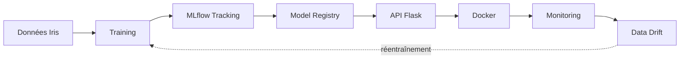
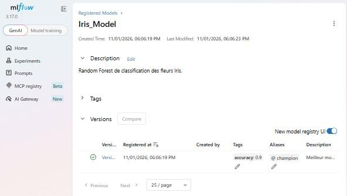
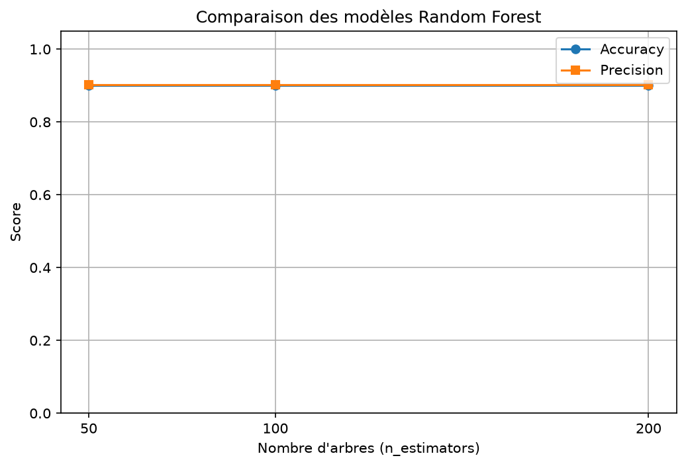

# Iris MLOps Pipeline — du modèle ML à la production


Projet réalisé dans le cadre des **TP1 et TP2 MLOps** de l'EMSI (Pr. Bakkali Yedri Othman).

Ce projet classe des fleurs Iris avec un Random Forest et met en place toute la chaîne MLOps : entraînement, suivi des expériences, Model Registry, API, Docker, surveillance du Data Drift et intégration continue.



## Sommaire

- [Fonctionnalités](#fonctionnalités)
- [Structure du projet](#structure-du-projet)
- [Installation](#installation)
- [Utilisation](#utilisation)
- [MLflow et Model Registry](#mlflow-et-model-registry)
- [API](#api)
- [Docker](#docker)
- [Résultats](#résultats)
- [Synthèse Data Drift](#synthèse-data-drift)
- [Tests et CI](#tests-et-ci)
- [DevOps et MLOps](#devops-et-mlops)

## Fonctionnalités

| Étape | Réalisation | Fichier |
|---|---|---|
| Entraînement | 3 Random Forest (50, 100 et 200 arbres) | `src/train.py` |
| Suivi | Paramètres, métriques et modèles dans MLflow | `src/train.py` |
| Registry | Meilleur modèle enregistré avec l'alias `champion` | `src/train.py` |
| Prédiction | Depuis le fichier local ou depuis le registry | `src/predict.py`, `src/predict_registry.py` |
| API | `/`, `/health`, `/version`, `/predict` | `src/api.py` |
| Docker | Image contenant l'API et le modèle | `Dockerfile` |
| Monitoring | Comparaison des statistiques et alerte de drift | `src/drift.py` |
| Qualité | Tests automatiques et CI GitHub Actions | `tests/`, `.github/workflows/` |

## Structure du projet

```text
mlops-tp1/
├── .github/workflows/mlops-ci.yml   # Pipeline CI
├── data/                            # Nouvelles données simulées
├── docs/                            # Captures d'écran
├── experiments/                     # Graphique et rapport de drift
├── models/                          # Modèle final et sa version
├── src/
│   ├── train.py                     # Entraînement, MLflow, registry
│   ├── predict.py                   # Prédiction avec le fichier .pkl
│   ├── predict_registry.py          # Prédiction avec le registry
│   ├── api.py                       # API Flask
│   └── drift.py                     # Détection du drift
├── tests/                           # Tests pytest
├── Dockerfile
├── pytest.ini
└── requirements.txt
```

`mlflow.db` et `mlruns/` sont créés par `train.py`. Ils restent en local, car ils contiennent des chemins propres à chaque machine.

## Installation

**Prérequis :** Python 3.12, Git, et Docker pour la partie conteneur.

```powershell
git clone https://github.com/rania48/iris-mlops-pipeline-tp1.git
cd iris-mlops-pipeline-tp1
python -m venv .venv
.\.venv\Scripts\Activate.ps1
pip install -r requirements.txt
```

Si PowerShell bloque l'activation :

```powershell
Set-ExecutionPolicy -ExecutionPolicy RemoteSigned -Scope CurrentUser
```

Dans l'invite de commandes (cmd), l'activation se fait avec `.venv\Scripts\activate.bat`.

## Utilisation

Lancer les commandes dans cet ordre, depuis la racine du projet :

```powershell
python src/train.py              # Entraîne et enregistre le meilleur modèle
python src/predict.py            # Prédit avec models/iris_model.pkl
python src/predict_registry.py   # Prédit avec Iris_Model@champion
python src/drift.py              # Compare les données et affiche l'alerte
pytest                           # Lance les tests
```

> Après un `git clone`, lancer d'abord `python src/train.py` : il crée la base MLflow locale, nécessaire à `predict_registry.py` et à l'interface MLflow.

## MLflow et Model Registry

Démarrer l'interface :

```powershell
mlflow ui --backend-store-uri sqlite:///mlflow.db --port 5001
```

Puis ouvrir <http://127.0.0.1:5001>.

- **Experiments → Iris_MLOps** : les runs `RF_50`, `RF_100` et `RF_200` avec leurs paramètres et métriques.
- **Model training → Model registry → Iris_Model** : les versions du modèle et l'alias `champion` (accès direct : <http://127.0.0.1:5001/#/models/Iris_Model>).

> Le port `5001` évite le conflit avec l'API, qui utilise le port `5000`.

À chaque exécution de `train.py` :

1. les trois modèles sont entraînés et suivis dans MLflow ;
2. le meilleur est choisi selon l'accuracy (en cas d'égalité, celui qui a le moins d'arbres) ;
3. une nouvelle version de `Iris_Model` est créée ;
4. l'alias `champion` pointe vers cette version.

L'alias permet de charger le modèle sans connaître son numéro de version :

```python
model = mlflow.sklearn.load_model("models:/Iris_Model@champion")
```



## API

```powershell
python src/api.py
```

| Méthode | Route | Rôle |
|---|---|---|
| GET | `/` | Informations sur le service |
| GET | `/health` | État de l'API et du modèle |
| GET | `/version` | Version du modèle utilisé |
| POST | `/predict` | Prédit la classe d'une fleur |

Les `features` sont, dans l'ordre : longueur du sépale, largeur du sépale, longueur du pétale et largeur du pétale (en cm).

Exemple avec PowerShell :

```powershell
Invoke-RestMethod http://127.0.0.1:5000/predict -Method Post -ContentType "application/json" -Body '{"features": [5.1, 3.5, 1.4, 0.2]}'
```

Réponse :

```json
{
  "prediction": 0,
  "class_name": "setosa",
  "model_version": 1
}
```

Si les données sont invalides, l'API répond avec le code `400`.

## Docker

```powershell
docker build -t mlops-tp2:1.0 .
docker run --name mlops-tp2 -p 5000:5000 mlops-tp2:1.0
```

L'API est ensuite disponible sur <http://127.0.0.1:5000>. Les versions des bibliothèques sont fixées dans `requirements.txt` pour que le modèle se recharge à l'identique dans le conteneur.

## Résultats

Résultats sur le jeu de test (30 fleurs, 20 % des données) :

| Run | n_estimators | Accuracy | Precision (macro) |
|---|---:|---:|---:|
| RF_50 | 50 | 0,900 | 0,902 |
| RF_100 | 100 | 0,900 | 0,902 |
| RF_200 | 200 | 0,900 | 0,902 |



**Observations :**

- Les trois modèles obtiennent le même score : ajouter des arbres n'apporte rien ici.
- Le modèle à **50 arbres** est retenu, car c'est le plus simple et le plus léger à score égal.
- `setosa` est parfaitement reconnue. Les erreurs concernent `versicolor` et `virginica`, deux espèces plus proches.
- Le jeu de test est petit : une seule erreur fait varier l'accuracy de 3,3 points.

## Synthèse Data Drift

Le Data Drift est un changement de la distribution des données entre l'entraînement et la production. Ici, les données de production sont **simulées** : les pétales sont agrandis de 30 % et un léger bruit est ajouté (`data/nouvelles_donnees.csv`).

Le score de drift mesure le décalage de la moyenne en nombre d'écarts-types. Une alerte est levée au-delà de **0,5**. Le détail (moyenne, écart-type, minimum, maximum) est dans `experiments/rapport_drift.csv`.

| Variable | Moyenne référence | Moyenne nouvelle | Score | Alerte |
|---|---:|---:|---:|---|
| sepal length | 5,843 | 5,842 | 0,002 | Non |
| sepal width | 3,057 | 3,055 | 0,004 | Non |
| petal length | 3,758 | 4,885 | 0,638 | **Oui** |
| petal width | 1,199 | 1,558 | 0,471 | Non, mais proche du seuil |

Impact sur les classes prédites :

| Classe | Référence | Nouvelles données |
|---|---:|---:|
| setosa | 33,3 % | 33,3 % |
| versicolor | 34,0 % | 8,0 % |
| virginica | 32,7 % | 58,7 % |

**Réponses aux questions du TP :**

- **Quelle variable change ?** La longueur des pétales dépasse le seuil, et leur largeur s'en approche. Les sépales restent stables.
- **Quel impact ?** Le modèle classe beaucoup plus de fleurs en `virginica` (de 32,7 % à 58,7 %) : ses prédictions deviennent déformées, sans qu'aucune erreur technique n'apparaisse.
- **Quelles variables pourraient changer en production ?** Toutes les mesures, par exemple avec un nouvel instrument, une autre méthode de mesure, ou de nouvelles conditions de culture.
- **Quand réentraîner ?** Lorsqu'une alerte de drift persiste sur de vraies données, ou que les performances baissent. Il faut d'abord vérifier les données : le drift peut venir d'un problème de capteur. Après réentraînement, la nouvelle version n'est mise en production que si elle fait mieux que `champion`.

## Tests et CI

```powershell
pytest
```

Les 12 tests vérifient les routes de l'API, le rejet des données invalides et la détection du drift.

À chaque `push` ou `pull request` sur `main`, GitHub Actions :

1. installe les dépendances ;
2. entraîne le modèle ;
3. lance les prédictions et le contrôle du drift ;
4. exécute les tests ;
5. construit l'image Docker ;
6. démarre le conteneur et teste `/health` et `/predict`.

## DevOps et MLOps

| DevOps | MLOps |
|---|---|
| Code | Code + données + modèle |
| Tests | Tests + évaluation du modèle |
| Git | Git + MLflow (expériences et registry) |
| CI/CD | CI/CD + entraînement continu (CT) |
| Docker | Docker |
| Monitoring applicatif | Monitoring + drift + réentraînement |

## Auteur

**Rania** — EMSI — [@rania48](https://github.com/rania48)
